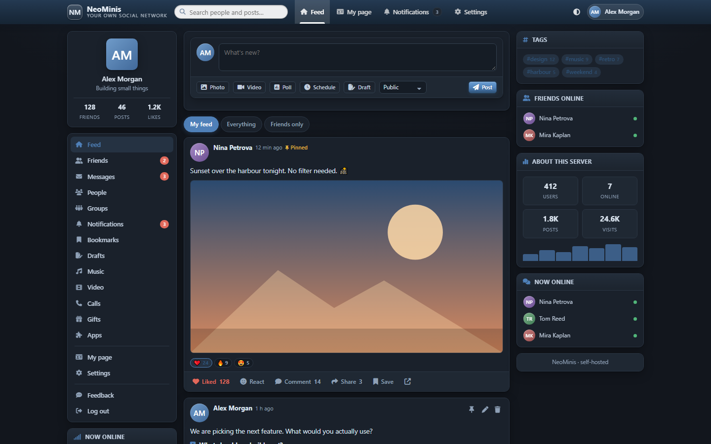
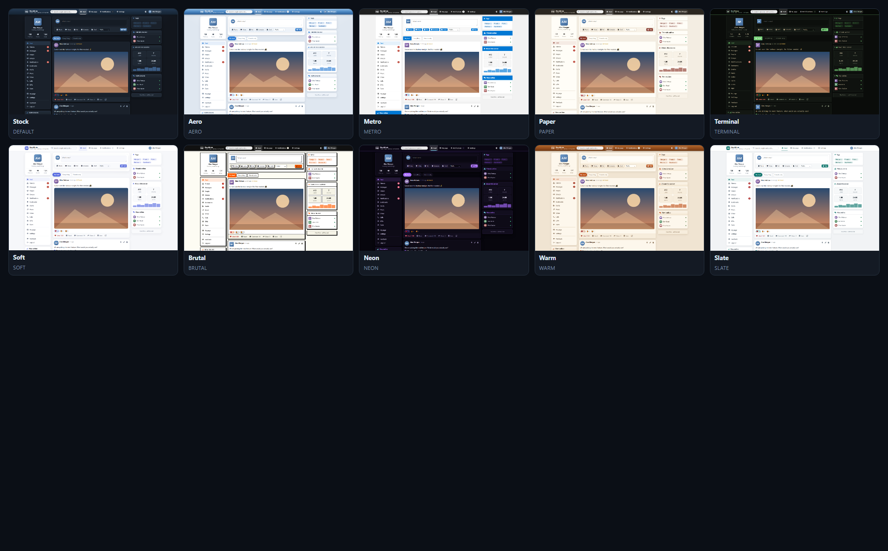
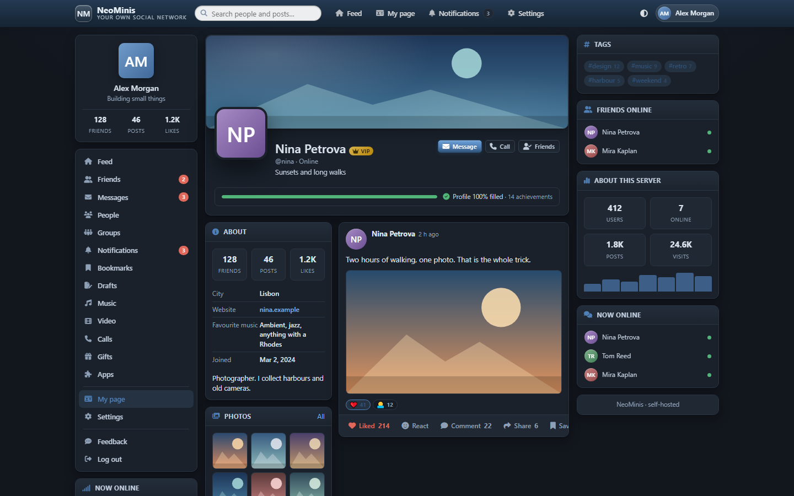
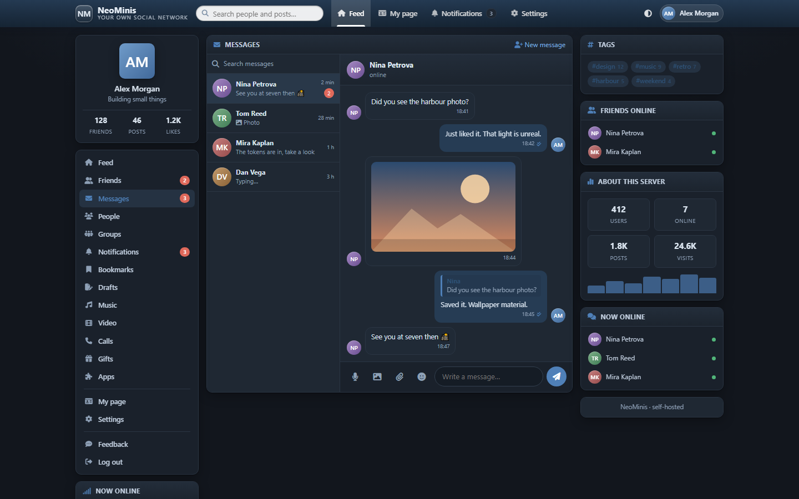
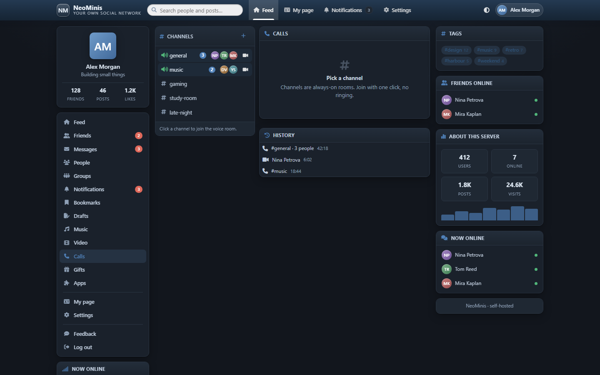
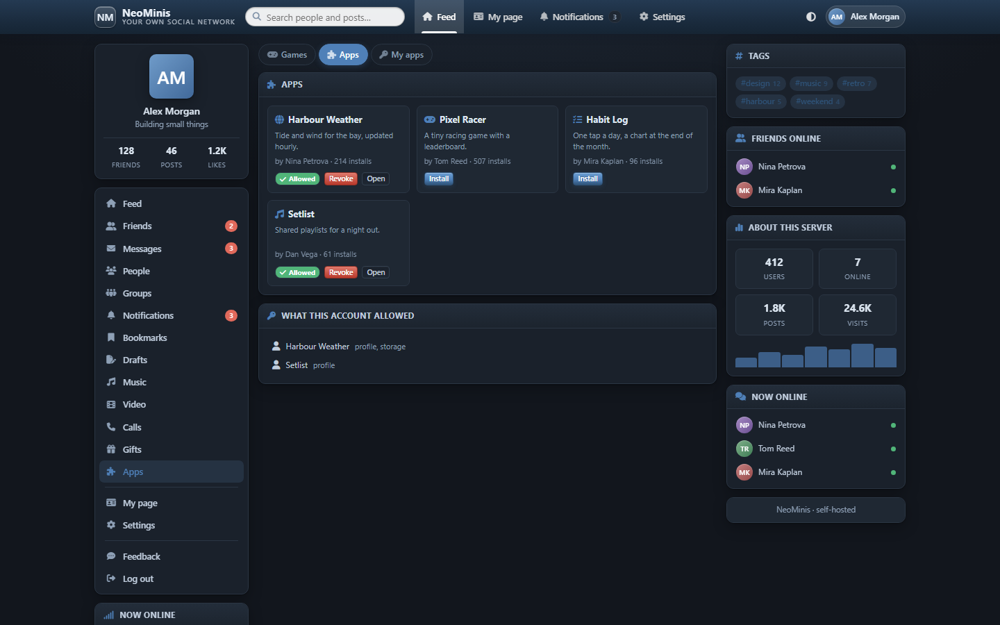
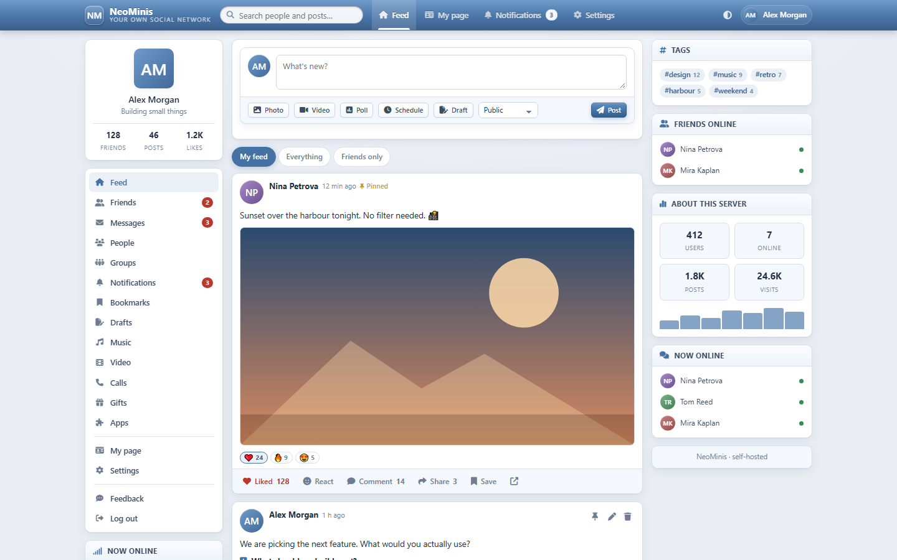
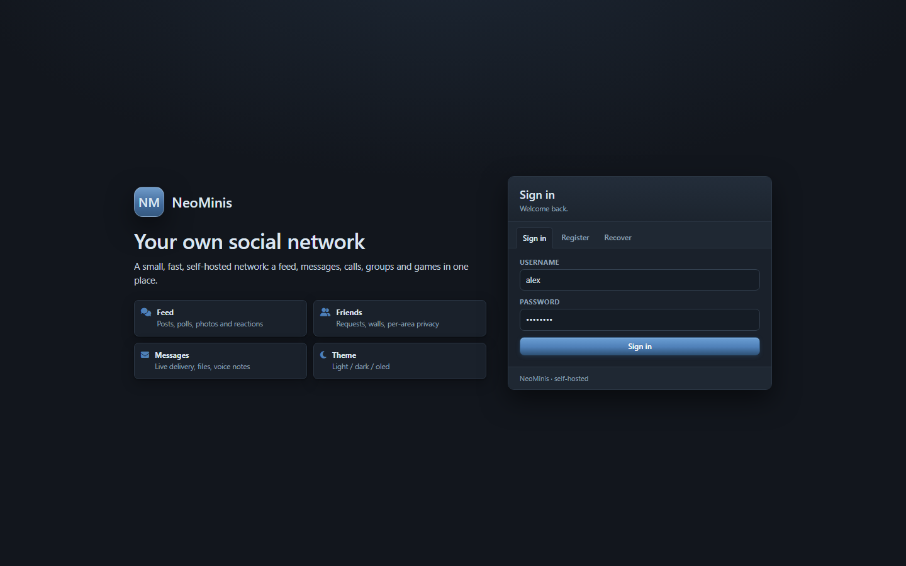

<div align="center">


# NeoMinis

**A small, fast, self-hosted social network that fits in one `.exe`.**

.NET Framework 4.0 · C# 4 · BCL only · no NuGet · no MSBuild · no database server
Runs on Windows XP SP3 and anything newer, including behind Nginx Proxy Manager

[](https://dotnet.microsoft.com/)
[](https://learn.microsoft.com/dotnet/csharp/)
[](#why-this-exists)
[](#testing)
[](#license)

[Quick start](#quick-start) · [Screenshots](#screenshots) · [Features](#features) · [Configuration](#configuration) · [API](#api-and-security) · [Docs](#documentation) · [Testing](#testing)

</div>



---

## Why this exists

Most social networks want a cloud account, a container runtime and a database
cluster. NeoMinis wants a folder and a double-click. It is one process, one
executable, and a pile of JSON files you can read with Notepad — no SQLite, no
ORM, no `npm install` before the first page loads.

It is also deliberately *branding-neutral*. The application ships no name, no
colours and no logo baked into its source: the site name, the palette and every
limit come from `config.ini`, and `[branding]` generates a `brand.css` on the fly,
so you can rebrand a deployment without editing a single file in `public/`. The
logo in this README is the project's, not the application's.

**What it is not:** a scalable platform. It is one process with a shared lock and
flat files, which is a great fit for a few hundred people on one box and a poor
fit for a million. That is the trade, made on purpose.

---

## Quick start

```cmd
build.cmd        :: compiles with the stock csc.exe, copies web assets to bin\
run.cmd          :: starts the server (bin\config.ini is created on first run)
```

Then open <http://localhost:55150/>. **The first registered account becomes an
administrator** (`site.firstUserAdmin=true`).

The **admin board** runs on its own port in the same process — by default
<http://localhost:55160/>. `/api/admin/` does not exist on the public port at all
(it answers `404`), so the admin surface is never reachable through a reverse
proxy unless you deliberately publish it.

```text
public board   55150   SPA, /api/… for members, /media/…
admin board    55160   the same SPA plus /api/admin/…
```

Both are configurable (`server.port` / `server.adminPort`, separate `bind`s and
fallback lists), and the admin board can be switched off entirely with
`server.adminEnabled=false` or `--no-admin`.

### Requirements

| | |
| --- | --- |
| **OS** | Windows XP SP3 or newer (the HTTP server is written on `TcpListener`, so no `netsh http add urlacl` and no `http.sys`) |
| **Runtime** | .NET Framework 4.0+ — ships with Windows 8 and newer |
| **Compiler** | `csc.exe` from `%WINDIR%\Microsoft.NET\Framework\v4.0.30319` — nothing else to install |
| **Browser** | any modern one; the SPA uses ES5 only, so old browsers degrade instead of breaking |

### Behind Nginx Proxy Manager

1. Point NPM at `http://<host>:55150`.
2. Keep `server.trustProxyHeaders=true`; the NPM host must be inside
   `server.trustedProxies` (private ranges are listed by default).
3. `cookieSecure=auto` sets the Secure flag when NPM sends `X-Forwarded-Proto: https`.
4. Set `site.baseUrl=https://your.domain` so links and the invite box are correct.
5. Optional sub-path: `server.publicBasePath=/social`.
6. Enable `security.hsts=true` only when TLS really terminates in front.
7. Do **not** publish the admin port through NPM unless you want it on the
   internet; if you do, give it its own hostname (e.g. `admin.your.domain`) and
   keep `security.adminPrivateOnly=false` only while you really need remote access.

---

## Screenshots

All screenshots are rendered from standalone demo pages that use the real
`app.css` with invented people and posts — no real instance data is shown.

**Fifteen templates ship with the interface, each with its own atmosphere effect.**
Same markup, same features, fifteen personalities — pick one in Settings, and pick the
effect separately if you want a different one:



| | | |
| --- | --- | --- |
| **Branded** — the 2008 chrome, `[branding]` styles this one | **Aero** — Vista gloss, tamed | **Metro** — 2012 flat tiles |
| **Paper** — cream and oxblood, serif | **Terminal** — a console, monospace | **Soft** — 2026 restraint |
| **Brutal** — thick rules, hard offsets | **Neon** — violet on black | **Warm** — terracotta and cream |
| **Slate** — teal on cool grey | **Matrix** — phosphor green rain | **Cyberpunk** — magenta and cyan |
| **New Year** — gold on midnight, snow | **Autumn** — burnt orange, leaves | **Horror** — blood on black, VHS |

<table>
<tr>
<td width="50%"><br><sub><b>Profile</b> — cover strip, completeness rating, achievements, photo grid</sub></td>
<td width="50%"><br><sub><b>Messenger</b> — live threads, replies, read receipts, attachments</sub></td>
</tr>
<tr>
<td><br><sub><b>Calls</b> — always-on voice channels with live occupancy</sub></td>
<td><br><sub><b>Apps</b> — games and third-party apps in one hub with consent</sub></td>
</tr>
<tr>
<td><br><sub><b>Light theme</b> — same page, instant switch</sub></td>
<td><br><sub><b>Login</b> — captcha, registration, account recovery</sub></td>
</tr>
</table>

---

## Features

| Area | What you get |
| --- | --- |
| **Feed** | home / everything / friends-only tabs, **a live "N new posts" pill** that never moves the list under you, posts with images, video links and polls, likes (with a "who liked" list), emoji reactions, comments, **reposts to your own wall**, edit and pin your own posts, **edit history** (the "edited" mark opens the earlier versions — for the author and the staff), **drafts and scheduled publication**, visibility (`public` / `friends` / `private`), delete with cascade |
| **Profiles** | avatar and cover, status, bio, city/country, birthday, gender, website, interests, mood, achievements, photo gallery, a **completeness rating**, friends wall, per-area privacy |
| **Friends** | requests, accept/decline, remove, block, incoming/outgoing lists, "friends online" |
| **Messages** | live delivery (long poll), typing indicator, read receipts, unread divider, replies with quotes, emoji reactions, forwarding, **search inside a conversation with jump-to-message**, **per-conversation drafts**, picture/GIF/album attachments, **voice messages**, **file attachments**, video clips, **sticker packs** (two built in, plus **your own uploaded packs, VIP only** — create, rename, share, delete), **paste a screenshot straight into the composer**, **delete for everyone** with tombstones, **pinned messages**, per-side delete. One "attach" menu holds photo, file, voice and the peer transfer, so the composer row stays three controls wide |
| **Calls** | 1:1 audio/video over WebRTC, **always-on voice channels**, **screen sharing** (instant, no renegotiation), **calls that survive a page reload**, **audio processing toggles** (echo cancel, noise suppression, auto-gain), speaking ring from a real audio level meter, mute badges, camera on mid-call, minimised floating window, avatars of who is on the line with a blue join dot, call history |
| **Groups** | public/private groups, membership, group feed, owner role, editable name/description/picture, member management, join requests, a post review queue, per-member roles |
| **Notifications** | likes, comments, reactions, reposts, friend requests, messages, mentions, badges, broadcasts, reports — delivered **live** over a long poll (instant toast, sound, tab title counter, optional desktop notification), per-type switches, All / Unread / Mentions filters, **grouped rows** ("Nina and 9 more"), paging, plus **Web Push** with a VAPID tickle |
| **Search** | people and posts, quick search in the top bar, post filters (type, author, tag, dates) and sorting (newest / oldest / popular) |
| **Media** | personal music and video shelves with upload, inline players, playlists, "save to my library" from somebody else's shelf, size and count limits |
| **Stories** | 24-hour photo and video stories with a progress bar, view tracking and per-story viewer lists |
| **Gifts** | a catalogue of 14 gifts, each with its own icon and colour, sent to a profile with a message |
| **Games and apps** | **four built-in mini-games** (Snake, 2048, Memory, Minesweeper — plain HTML, no plugin, themed to match the site, with a leaderboard each), a Flash shelf through vendored Ruffle, and a real **Applications API** — third-party apps register, get scopes, ask for consent, exchange a code for a bearer token, get per-user storage with a quota, and publish leaderboards |
| **Achievements** | 34 badges, auto-granted from activity (posts, comments, likes, friends, messages, bookmarks, age) plus manual awards; admin can grant or revoke any badge |
| **Peer file transfer** | direct browser-to-browser transfer between friends with an 8-digit code, consent, SHA-256 verification and no server-side storage |
| **AI citizens** | imported personas that post, comment and like on their own — Markov chain or any OpenAI-compatible endpoint. Off by default. See [docs/AI.md](docs/AI.md) |
| **Admin** | **a separate board on its own port** — dashboard, users (ban / unban / grant or revoke admin & moderator / warn / mute / reset / badges / delete, with **All / Online / Staff / Banned / Deleted filters** that run server-side), reports queue, **a sticker-pack moderation tab** (every uploaded pack, private ones included, with a preview strip, a report count and a one-click delete that tells the owner), live log tail, broadcast, backup, storage repair, **a read-only storage audit** (folder sizes, biggest files, unreferenced files, records pointing at missing files), config reload, AI panel, and a Settings tab that writes straight back to `config.ini` |
| **Moderation** | a permission matrix for moderators (8 flags, empty means "all", for backwards compatibility), warnings, chat mutes, reports, per-IP account caps |
| **Themes** | `light` / `dark` / `oled`, instant switch, remembered per user, and a generated `brand.css` from `[branding]` |
| **Settings** | five tabs — Profile, Appearance, Notifications, Privacy, Account — instead of one long wall, so nothing is squeezed into an unreadable column. The Account tab carries **"delete my account"**: a real, irreversible removal behind a warning and a password, which takes your posts, messages, photos and sticker packs with it |
| **Templates** | **15 interface skins** — Branded, Aero, Metro, Paper, Terminal, Soft, Brutal, Neon, Warm, Slate, Matrix, Cyberpunk, New Year, Autumn, Horror. A skin is a palette plus a shape language on `data-skin` and changes no markup, so layout and behaviour are identical in all of them. Chosen per account, remembered per browser, defaulted by the admin, and lockable so only staff may change it. See [DESIGN.md §12.1](docs/DESIGN.md) |
| **Effects** | **12 atmosphere layers** on `data-fx` — film grain, CRT scanlines, VHS tape, matrix rain, glitch, snow, falling leaves, aurora, neon glow, glass sheen, print offset. Pure CSS (no canvas, no WebGL), each skin carries its own default, and the user can pick any effect independently or turn it off. See [DESIGN.md §12.2](docs/DESIGN.md) |
| **Holiday themes** | `ui.skinSchedule` switches the template by date (`horror:10-25:11-02,newyear:12-20:01-10`) with no client release and no restart, and `GET /api/theme` exposes the current look publicly so a launcher or script can follow it |
| **Sounds** | WebAudio synth (no audio files): click, post, like, comment, message, notification, friend, login, error, success, theme — with per-event toggles and volume. **Each template has its own synth voice**, and there are **6 standalone sound sets** (classic, arcade, acoustic, minimal, chiptune, deep) that ignore the look |
| **Font sets** | **7 typography sets** — system, serif, mono, humanist, compact, classic, elegant. Only fonts that ship with Windows, so nothing is downloaded and nothing shifts while loading |
| **i18n** | **English and Russian complete**; Ukrainian and Lithuanian cover the shell and fall back to English for the rest. Auto-detect plus a selector |
| **Guest mode** | a real read-only session (not an auth bypass) with an endpoint whitelist, optional password, and a kiosk mode with idle timeout |
| **Security** | PBKDF2-HMAC-SHA256 logins, HMAC-signed and encrypted `/api/`, single-use SVG captcha, rate limits, bans, CSP / XFO / nosniff, `Permissions-Policy` for camera and mic |
| **Resilience** | supervisor with exponential backoff, port fallbacks, atomic JSON writes, `.bak` recovery, read-only degraded mode, snapshots, quarantine of corrupt files |
| **Logging** | `Trace` with one rolling file listener in `logs/` (`social-YYYYMMDD.log`), levels, retention — no `App.config`, no console duplication |

---

## Layout

```text
build.cmd                stock csc.exe build, no NuGet/MSBuild
run.cmd                  start from bin\
config.example.ini       every setting, documented (169 keys)
src/SocialServer/
  Program.cs             CLI, crash handler, --selftest / --backup / --import-deadvk
  SocialApp.cs           owns store, sessions, stats, captcha, media, AI, web
  AppSupervisor.cs       watchdog + debounced saves + snapshots + cleanup
  ConsoleUi.cs           TUI: ASCII banner, operator prompt, no log echo
  SelfTest.cs            crypto vectors, envelope tampering, JSON, captcha, storage
  Core/                  Config, Log, Crypto, Json, Models, SocialStore, Sessions,
                         Captcha, Media, StatsStore, Store (atomic IO), Util,
                         Branding, Perms, Privacy, ProfileScore, Polls, Reactions,
                         Badges, Gifts, Calls, Transfers, WebPush, AppScopes,
                         Ai + AiRunner, DeadVkImport, Cli
  Web/                   HttpCore (HTTP/1.1), WebServer (static/media/routing),
                         ApiRouter (auth, views, social, admin, ai, calls,
                         channels, apps, games, gifts, stories, push, transfers,
                         albums, communities, search, settings)
public/                  SPA: index.html, 404/403, assets/css, assets/js
  assets/js/             crypto, api, app, app.more, calls, apps, games, gifts,
                         stories, transfers, push, i18n, ui, sound, player
  assets/stickers/       the built-in sticker packs (SVG) + manifest.json
                         (uploaded packs live in bin/data/media/stickers)
  assets/mini/           the built-in mini-games: sdk, css, snake, 2048,
                         memory, mines - plain HTML/canvas, no plugin needed
docs/                    ARCHITECTURE, API, CLI, AI, IMPORT, ROADMAP, img/
tools/                   firewall, test-web.mjs, ci-test.ps1, rename-user.mjs,
                         make-logo.mjs, make-demo-screens.mjs
```

Runtime folders (git-ignored): `bin/`, `data/`, `logs/`, `config.ini`.

Roughly **23k lines of C#**, **12.6k lines of JavaScript** and **2.1k lines of
CSS**, with **138 API routes** and zero external packages.

---

## Configuration

All settings live in `config.ini` (UTF-8, INI). `config.example.ini` documents
every key; the important ones:

```ini
[site]
name=Social
shortName=S
tagline=Your own social network
defaultLanguage=ru          ; ru | en | uk | lt
defaultTheme=light          ; light | dark | oled
registration=true
inviteOnly=false
firstUserAdmin=true

[server]
port=55150
portFallbacks=55151,55152,55153
bind=0.0.0.0

; admin board: own listener, own port, /api/admin/ lives only here
adminEnabled=true
adminPort=55160
adminPortFallbacks=55161,55162,55163
adminBind=0.0.0.0
publicBasePath=             ; e.g. /social behind a proxy
trustProxyHeaders=true
trustedProxies=127.0.0.1,::1,10.0.0.0/8,172.16.0.0/12,192.168.0.0/16
cookieSecure=auto
sessionHours=168
sessionMaxHours=720

[security]
serverSecret=               ; generated on first run
cookieSalt=                 ; generated on first run
kdfIterations=12000
encryptApi=true
requireCaptcha=true
adminPrivateOnly=false

[limits]
requestsPerMinute=900
registrationsPerHour=20
postsPer10Min=20
messagesPerMin=40
maxPostLength=8000
maxAvatarKB=512
maxPostImageKB=4096

[storage]
backupIntervalMin=30
backupKeep=24
readOnlyOnError=true

[logging]
level=Info                  ; Error | Warn | Info | Debug | Verbose
apiTrace=true
maxFileMB=8
retentionDays=14

[ai]
provider=off                ; off | markov | openai
enabled=false
; any OpenAI-compatible /chat/completions endpoint
endpoint=http://localhost:1234/v1/chat/completions
model=local-model
intervalSec=180
```

Every setting here is also editable from **Admin → Settings**, which writes back
to `config.ini`. Changing `port`, `bind`, `adminPort`, `webRoot` or `dataDir` needs
a restart; everything else can be re-read with `R` in the console or
`POST /api/admin/reload`.

CLI overrides: `--port N`, `--admin-port N`, `--no-admin`, `--bind IP`,
`--config PATH`, `--data DIR`, `--no-console`.

### Rebranding a deployment

The **Branded** template is the one `[branding]` styles — every other template brings
its own palette, so a brand accent layered over `neon` would fight it.

```ini
[branding]
accent=#0088ff
accentHi=#33a0ff
accentLo=#0080ff
darkAccent=#0088ff
darkBg=#070c14
darkPanel=#0e1725
```

The server generates `/brand.css` from this section and the SPA links it after
`app.css`, so the repository itself stays neutral. Leave the section empty for the
stock palette. Hover, link, top-bar and cover colours are all derived by mixing,
so you only give the handful of base colours.

### Adding a language

A language is one object in `public/assets/js/i18n.js`, plus one entry in the
selector. Nothing on the server has to change:

```js
pl: {
  'nav.feed': 'Aktualności',
  'nav.friends': 'Znajomi',
  // …any subset; a missing key falls back to English, then Russian, then the key
},
```

`i18n.t()` resolves `lang → en → ru → key`, so a half-finished dictionary shows
English instead of `nav.feed` on screen. Then add the code to the `languages` array
in `SiteJson` (`src/SocialServer/Web/ApiRouter.cs`) so the selector offers it, and
to the admin dropdown in Settings if you want it as a default. The shipped state
is: English and Russian complete (~1.2k keys each), Ukrainian and Lithuanian at 39
keys each (the shell and the auth forms).

---

## API and security

Passwords and tokens never travel over the wire, and no plaintext body does
either. Details: **[docs/API.md](docs/API.md)**.

```text
verifier  = PBKDF2-SHA256(password, "social.login.v1|username", N, 32)
K         = PBKDF2-SHA256(verifier, sessionSalt, N, 32)
request   = METHOD \n path?query \n timestamp \n nonce \n sha256(body)
signature = HMAC-SHA256(HMAC(K, "social.v1.mac"), request)
body      = base64( iv16 | HMAC-CTR(HMAC(K, "social.v1.enc"), iv) XOR json | tag16 )
```

Pure BCL (`HMACSHA256`, `RNGCryptoServiceProvider`), mirrored bit-for-bit in
`public/assets/js/crypto.js`. A captured request cannot be replayed (nonce and
timestamp), altered (signature) or read (encryption) — and the same code path
serves the browser, the test suite and the CLI.

Additional layers:

- **Two listeners, one process.** The public board returns `404` for
  `/api/admin/` — the admin surface does not exist there at all.
- **Guest mode is a real signed session** with `UserId = 0` plus an endpoint
  whitelist, never an auth bypass.
- **Per-IP account cap** (`site.accountsPerIp`) to blunt throwaway registrations.
- **Single-use SVG captcha** with an HMAC-bound code, plus rate limits and bans.

---

## Testing

```cmd
bin\SocialServer.exe --selftest                  :: crypto vectors, sealing, JSON, captcha, storage
node tools\test-web.mjs http://127.0.0.1:55150 http://127.0.0.1:55160
powershell -ExecutionPolicy Bypass -File tools\ci-test.ps1
```

`ci-test.ps1` builds, runs the self-test, starts a clean instance in a temp
folder, runs the Node suite against **both boards**, restarts the server and
verifies that data survived.

`tools/test-web.mjs` speaks the same crypto as the browser: **645 checks** covering
registration, login, signature enforcement, replay rejection, encryption
enforcement, posts, likes, comments, friends, messages, groups, notifications,
calls, channels, apps, push, transfers, admin actions, recovery and logout.

Admin checks need an administrator's credentials and the admin board address:

```powershell
$env:SOCIAL_ADMIN_USER="admin"; $env:SOCIAL_ADMIN_PASSWORD="..."
node tools\test-web.mjs http://127.0.0.1:55150 http://127.0.0.1:55160
```

### Regenerating the artwork

```cmd
node tools\make-logo.mjs               :: docs/img/logo.png from the same geometry as the SVG
node tools\make-demo-screens.mjs       :: docs/img/screenshot-*.png from standalone demo pages
```

The screenshots come from self-contained demo HTML that uses the real `app.css`
with invented people and posts, so README images never leak a real instance's
content. Both scripts need Node 22+ (for a global `WebSocket`) and a locally
installed Chrome or Edge to render — no other dependency and no network access.
`--keep` writes the demo pages to `bin/demo/` if you want to poke at them.

---

## Maintenance

```cmd
bin\SocialServer.exe --backup                     :: snapshot data/ and exit
bin\SocialServer.exe --cmd "user list humans"     :: any console command, server may be stopped
bin\SocialServer.exe --cmd "user role 9 admin"    :: promote an account
bin\SocialServer.exe --reset-admin NAME           :: same thing, older spelling
bin\SocialServer.exe --import-deadvk <db folder>  :: import an old history
node tools\rename-user.mjs old new "New Name" [password]
```

`--cmd` accepts every command of the interactive console (`help`, `status`,
`user …`, `post del …`, `recovery export`, `import purge-bots`, `ai …`,
`broadcast`, `backup`, `reload`). Full reference: **[docs/CLI.md](docs/CLI.md)**.

`rename-user.mjs` re-derives the login verifier, because it is bound to the
username (`social.login.v1|username`) — without that the account would be locked
out.

### Windows Firewall

```cmd
tools\firewall.cmd              :: LAN / private sources (default, for a reverse proxy)
tools\firewall.cmd -PublicAny   :: allow the ports from anywhere (direct expose)
tools\firewall.cmd -Remove      :: delete the "Social Server" rules
```

---

## Documentation

| | |
| --- | --- |
| [docs/ARCHITECTURE.md](docs/ARCHITECTURE.md) | How the process, storage and HTTP stack fit together |
| [docs/DESIGN.md](docs/DESIGN.md) | The visual system: every token, component, animation and breakpoint, plus the ten templates and what not to do |
| [docs/DESIGN-RESEARCH.md](docs/DESIGN-RESEARCH.md) | What to borrow from the current motion references, what to refuse, and the plan for the next visual pass |
| [docs/API.md](docs/API.md) | Every endpoint, the envelope, errors, long polls |
| [docs/CLI.md](docs/CLI.md) | The operator console and `--cmd` |
| [docs/AI.md](docs/AI.md) | AI personas: Markov and OpenAI-compatible providers |
| [docs/IMPORT.md](docs/IMPORT.md) | Importing an old database |
| [docs/ROADMAP.md](docs/ROADMAP.md) | What is done and what is parked, honestly |

---

## Troubleshooting

| Symptom | Cause / fix |
| --- | --- |
| `[ERROR] csc.exe ... not found` | install .NET Framework 4.x (ships with Windows 8+) |
| `port 55150 is busy` | another instance or service; the server tries `portFallbacks` and logs the port it took |
| Everyone is logged out after a restart | by design: session keys live in memory only |
| `Storage is read-only` | a write failed (disk full / permissions). Fix it, then Admin → *Repair storage* |
| "Wrong username or password" but it is correct | username is case-insensitive, password is exact; `security.kdfIterations` must not change after registration |
| Behind a proxy everyone looks like `127.0.0.1` | add the proxy to `trustedProxies`, keep `trustProxyHeaders=true` |
| Admin menu is missing | you are on the public board: open the admin port (`server.adminPort`), the SPA tells you where it is |
| A call never connects | symmetric NAT: configure `limits.callTurn` / `callTurnUser` / `callTurnPass` |
| AI posts nothing | check Admin → AI: provider/enabled, then *Test connection*. Reasoning models need `maxTokens` around 1000+ |
| AI writes nonsense | that is the Markov provider learning from old posts; switch to `openai` or raise `temperature` / `intervalSec` |
| Secure cookie not set behind HTTPS | set `cookieSecure=true` or make the proxy send `X-Forwarded-Proto: https` |
| Captcha unreadable | click it for a new code; disable with `security.requireCaptcha=false` |
| `data/*.json` corrupt after a crash | the server restores `.bak` automatically and quarantines the broken file as `*.bad-YYYYMMDD-HHMMSS` |

---

## License

Use it, fork it, rebrand it. Attribution appreciated, not required.

Vendored third-party assets keep their own licences — see
`public/assets/vendor/ruffle/LICENSE_*` for Ruffle (MIT / Apache-2.0).
